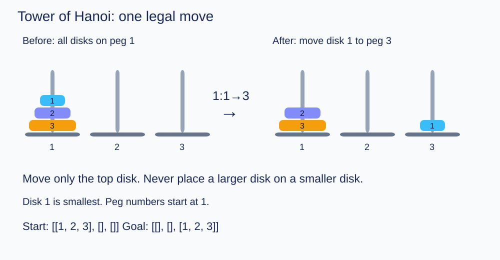
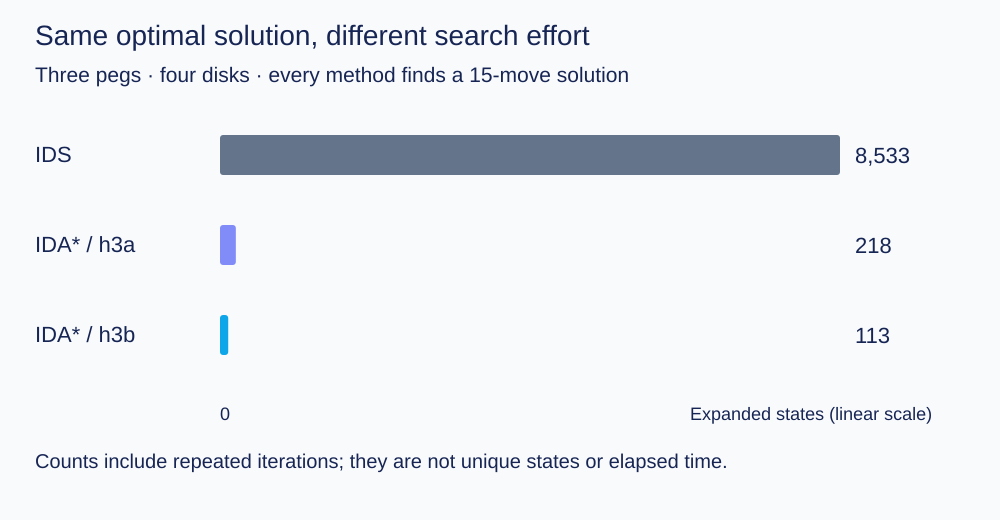
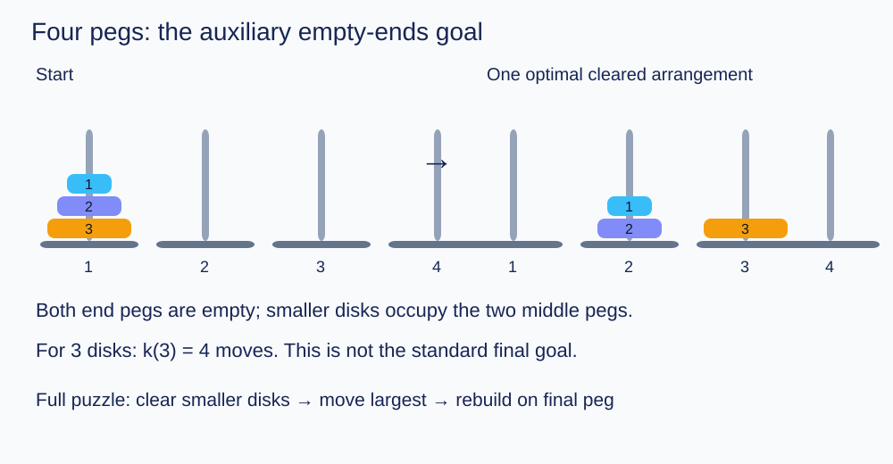
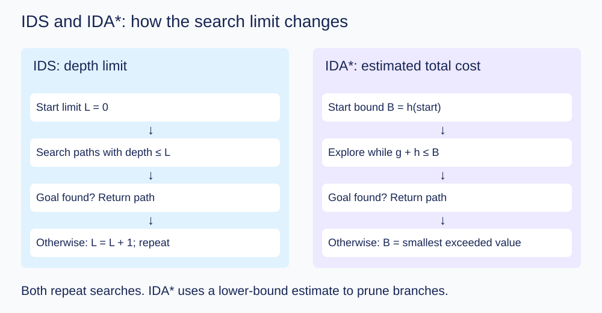

# Tower of Hanoi: IDS and IDA*

A Python search project comparing iterative deepening search and admissible
heuristics on the three- and four-peg Tower of Hanoi puzzle. The repository
includes legal solution paths, expanded-state counts, a fully executed notebook
and automated checks against independent small-state breadth-first distances.

For a detailed Chinese walkthrough, see [read.md](read.md), including setup,
CLI parameters, heuristic definitions, output interpretation and troubleshooting.

## Features

- Iterative Deepening Search (IDS) and Iterative Deepening A* (IDA*).
- Three-peg heuristics `h3a` and the stronger `h3b`.
- Four-peg heuristic `h4a`, using precomputed auxiliary values k(0)…k(6).
- Cycle checking **on the current path only**, with a fresh path on each iteration.
- An expansion is counted exactly when successors are generated; goal-only tests
  do not count. Counts include all iterations and preserve starter successor order.
- Lightweight copies of peg lists and path membership sets improve runtime
  without changing state ordering or expansion counts.
- The search discovers the paths; known formulas are used for checks and bounds.
- Core code has no NumPy or other third-party dependency.

## Quick start

Use Python 3.10 or newer. From the project directory:

```bash
python hanoi.py --disks 4 --pegs 3 --algorithm ida --heuristic 3b
python hanoi.py --disks 4 --pegs 4 --algorithm ida --heuristic 4a
python -m unittest discover -s tests -v
```

To run the experiment suite:

```bash
python experiments.py --quick
python experiments.py
```

`--quick` skips the three largest cases. The full suite includes h3b with 6 disks,
k(6), and h4a with 7 disks. These cases require millions of expansions and may take
several minutes depending on the computer. The full recorded results are already
included in `report.ipynb`, `results/results.json` and `results/run.log`.

Optional notebook environment:

```bash
python -m pip install -r requirements-notebook.txt
python -m jupyterlab report.ipynb
```

Run notebook cells from top to bottom with the project directory as the working
directory. There is no package-installation command inside the notebook.

## Representation and rules

A state is a list of pegs. Each peg lists its disks from smallest/top to
largest/bottom. For example, `[[1, 2, 3], [], []]` is the three-disk start.
Each action moves one top disk, and no larger disk can be placed on a smaller
one. Action `2:1->3` means moving disk 2 from peg 1 to peg 3.



Move disk 1 from peg 1 to peg 3; only the top disk can move.

## Recorded results

| Algorithm / heuristic | Pegs | Disks | Optimal moves | Expanded states |
|---|---:|---:|---:|---:|
| IDS | 3 | 4 | 15 | 8,533 |
| IDA* / h3a | 3 | 4 | 15 | 218 |
| IDA* / h3a | 3 | 5 | 31 | 18,937 |
| IDA* / h3b | 3 | 4 | 15 | 113 |
| IDA* / h3b | 3 | 5 | 31 | 5,591 |
| IDA* / h3b | 3 | 6 | 63 | 8,033,606 |
| IDA* / h4a | 4 | 7 | 25 | 9,176,981 |

Successor ordering affects expanded counts. A global visited set would change
this experiment and is deliberately not used.



All three methods find 15 moves. Bar lengths show cumulative expansions on a linear scale.

## Four-peg relationship

Let k(d) be the minimum number of moves needed to clear both the initial and final
pegs, distributing all disks over the two middle pegs. The computed values are:

| d | 0 | 1 | 2 | 3 | 4 | 5 | 6 |
|---|---:|---:|---:|---:|---:|---:|---:|
| k(d) | 0 | 1 | 2 | 4 | 6 | 8 | 12 |

For d >= 1, **f(d, 4) = 2k(d−1) + 1**. Clear the smaller disks, move the largest
disk once, and reverse the clearing process with initial and final pegs exchanged.
The matching lower bound comes from clearing before the largest disk first moves
and from the reversed suffix after its last move. The notebook includes the full
argument. The four-peg solution lengths for d=1…7 are 1, 3, 5, 9, 13, 17 and 25.



The illustrated three-disk auxiliary goal leaves both end pegs empty.

## Files

```text
hanoi.py                 Puzzle states, heuristics, search and single-case CLI
experiments.py           Reproducible full and quick experiment suites
report.ipynb             Executed notebook with paths, counts and explanations
read.md                  Chinese usage guide
results/results.json     Full machine-readable experiment output
results/run.log          Complete captured output
tests/test_hanoi.py       Path, count, dominance and admissibility checks
.github/workflows/       GitHub Actions test workflow
```

## Boundaries

This project supports three and four pegs. The supplied four-peg heuristic table
supports at most seven disks. The auxiliary empty-ends experiment uses IDS and
four pegs. Puzzle configuration is held on the starter `State` class; solve calls
should be made sequentially rather than concurrently in the same process.


## Command-line reference

| Option | Meaning | Default |
|---|---|---|
| `--disks` | Non-negative number of disks | `4` |
| `--pegs` | Number of pegs: `3` or `4` | `3` |
| `--algorithm` | `ids` or `ida` | `ida` |
| `--heuristic` | `3a`/`3b` for three pegs; `4a` for four pegs | Selected by peg count |

IDS does not use heuristic pruning. Use `python hanoi.py --help` for help.
On systems where Python is named `python3`, substitute that command throughout.

## How the search works

IDS repeats depth-limited depth-first search with limits starting at zero. With
unit move costs, the first solution is a shortest path. IDA* instead bounds
`g + h`, where `g` is the cost so far and `h` estimates the remaining cost. Its
next threshold is the smallest value that exceeded the previous threshold.

For h3a, let c be the largest disk not yet in the correct bottom suffix of the
final peg. The estimate is `2^(c-1)`, or zero at the goal. h3b also examines the
contents of the final peg: when it is empty the estimate is `2^(d-1)`; when its
bottom disk c is smaller than d, it is `2^(c-1) + 2^(d-1)`; once d is on the final
peg, it is `2^(c-1)` for the largest disk c outside that peg. The goal value is zero.
For four pegs, h4a uses `1 + k(c-1)` for the largest disk c outside the final peg,
and zero at the goal.

The four-disk three-peg results illustrate the difference between solution quality
and search effort: all three configurations find 15 moves, while IDS expands
8,533 states, h3a expands 218, and h3b expands 113. Expansion counts include
repeated work across thresholds; they are not counts of unique states or timings.



IDS increases the depth limit; IDA* updates the bound using the smallest exceeded g + h value.

## Experiment outputs and Python API

Quick experiments write `results/quick_results.json`; full experiments overwrite
`results/results.json`. Each case records its configuration, solution length,
expanded-state count and move list. The driver prints output but does not update
the included `results/run.log` automatically. To capture a new log:

```bash
python experiments.py > results/new_run.log
```

The quick suite runs h3b through five disks, auxiliary k values through k(4), and
h4a through five disks, alongside the IDS and h3a cases. Full mode extends these
to six disks, k(6), and seven disks respectively.

For programmatic use, `solve()` returns `(moves, expanded_states)`:

```python
from hanoi import solve

moves, expanded = solve(disks=4, pegs=3, algorithm="ida", heuristic="3b")
print(len(moves), expanded)

# Auxiliary four-peg goal: both end pegs must be empty.
moves, expanded = solve(disks=4, pegs=4, algorithm="ids", goal="empty_ends")
```

Call the solver sequentially because its configuration is stored on `State`.
The auxiliary goal is available through this API and the experiment suite, not
through a command-line goal option. In the relationship above, `f(d,4)` denotes
the optimal move count, distinct from the IDA* evaluation `f = g + h`.
